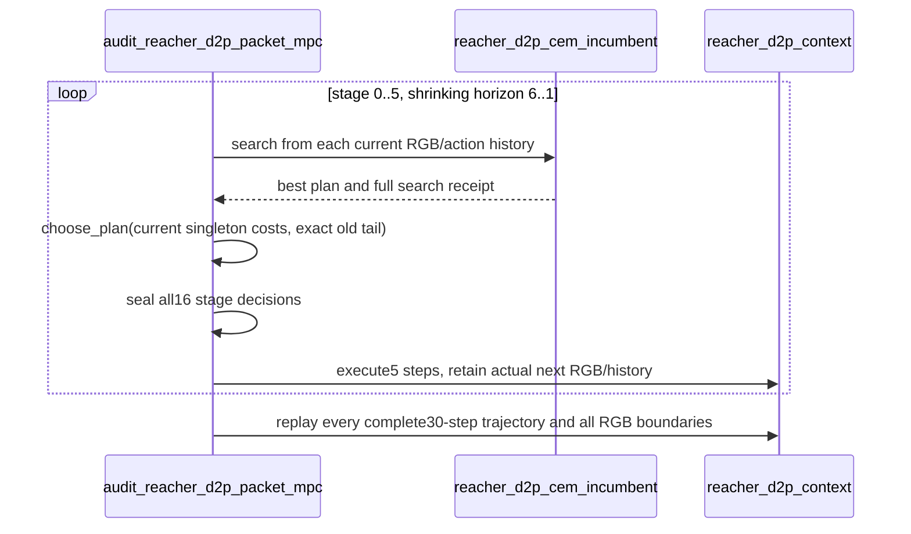

# D2P：逐包真实反馈与精确计划携带的隔离审计

## 已验证结果

全部8个已知根保留，主机CUDA完成24条独立策略分支及16次完整重放，共40次
真实30步执行、129480个predict样本。所有分段RGB、完整动作/物理终态、原开环
CEM搜索轨迹及起始动作均精确复现。所有96个逐包决定按阶段统一封存，最后
16个动作决定在任何终态评价之前封存；物理标签不用于规划。

| 执行方式 | 平均真实关节距离 | 对原开环胜/负 |
|---|---:|---:|
| 原完整六包开环CEM | 0.1520070105 | — |
| 每包RGB观测 + 冷启动CEM | 0.1170038774 | 7/1 |
| 每包RGB观测 + 新搜/精确旧计划择优 | 0.1356003483 | 6/2 |

冷启动反馈对开环的描述性配对均差-0.0350031331，95%CI
[-0.0524904563,-0.0153495805]。携带对开环的CI跨零；携带对冷启动5胜/3负，
但均差+0.0185964709且CI跨零。旧计划40次可用决策中被选20次。
已知根、增加反馈和计算的干预不能当作独立效能、等资源或P1结果。

最难根202644006：开环/冷反馈/携带反馈距离为0.831375/0.789536/0.936192。
反馈修复多数根，但没有修复该根；按模型成本保留计划亦不保证物理改善。
随后发现该根目标wrist越界，参见[目标关节拓扑审计](D2P_GOAL_JOINT_LIMIT_REPAIR_20261026.md)。
不能把这批失败统称为模型或理论问题，更不能用额外反馈冒充非贪心机制收益。

## 算法合同与代码

`audit_reacher_d2p_packet_mpc`每执行5个真实动作，收集新RGB和实际动作历史；
剩余模型horizon依次为6、5、4、3、2、1。每次CEM固定128候选×3轮/16elite，
seed为root_seed+90000×stage。两种反馈模式共用同一随机规则；初始完整计划
必须精确复现历史receipt及动作。carry保留旧计划的原始参数，不做inverse-tanh，
并在当前实际RGB上下文重新评分，不复用旧cost；平局保留carry。



```latex
\begin{algorithm}[t]
\caption{Packet-wise RGB feedback with an exact carried incumbent}
\begin{algorithmic}[1]
\Require Frozen model $F$, RGB/action context $h$, target image $g$, fixed CEM seed rule
\Ensure Six sealed five-step commands, with no physical label in selection
\State $p_{-1}\gets\varnothing$
\For{$t=0,\ldots,5$}
  \State $q_t\gets\textsc{CEM}(F,h,g,H=6-t,128,3,16)$
  \State $p_t\gets\textsc{ChoosePlan}(q_t,\mathrm{tail}(p_{t-1}),h,g)$
  \State Seal all roots' choices for this stage
  \State Execute the first packet of $p_t$; observe and shift $h$
\EndFor
\State Evaluate only after all final packets were sealed; replay full trajectories
\end{algorithmic}
\end{algorithm}
```

`choose_plan`逐候选singleton评分、校验shape/有限成本，并精确保留旧参数。
每阶段预测样本数为$(384+k)(6-t)$，$k=1$或$2$；求和为129480（全审计），
不是单策略部署成本。CEM候选轨迹不注入carry，因此反馈/连续性与搜索分布改变
没有混为一项。张量计划空间O(Hd)，候选库O(128Hd)。

独立后处理`analyze_reacher_d2p_packet_mpc`逐根/模式/阶段重算96个决定，
验证exact tail、实际RGB历史、封存动作和compute；拒绝重复身份、物理标签、
陈旧history、错动作及错成本。26项相关代数/协议fixture通过，不算神经效能。

## 证据与复现

结果：`le-wm-main/results/reacher_d2p_packet_mpc_all8_20261026_cuda.json`，
sidecars包含protocol、六阶段哈希链、implementation与roots。driver v1的
`physical_branches=24`指独立策略分支；独立summary明确另加16次完整重放，
实际共40次30步执行，未隐藏重放工作。两张全根PNG/PDF、summary、图注和
已验证SHA manifest：`le-wm-main/results/reacher_d2p_packet_mpc_figures_20261026/`。

以下神经命令须获授权在主机CUDA执行，输出必须不存在：

```bash
cd /home/gbk/code/LeWorldModel/le-wm-main
.venv/bin/python -u -m experiments.spectral_reachability.audit_reacher_d2p_packet_mpc \
  --reference results/reacher_d2p_state_native_selector_all136_20261026_cuda.json \
  --policy /home/gbk/.stable_worldmodel/checkpoints/reacher/lewm \
  --adapter-artifact results/reacher_d2p_p1_distribution_repair_v1_20261024_cuda/reacher_training_action_stats.json \
  --output /absolute/new-packet-mpc-audit.json
.venv/bin/python -m experiments.spectral_reachability.analyze_reacher_d2p_packet_mpc \
  --report /absolute/new-packet-mpc-audit.json --output-dir /absolute/new-packet-mpc-figures
```
