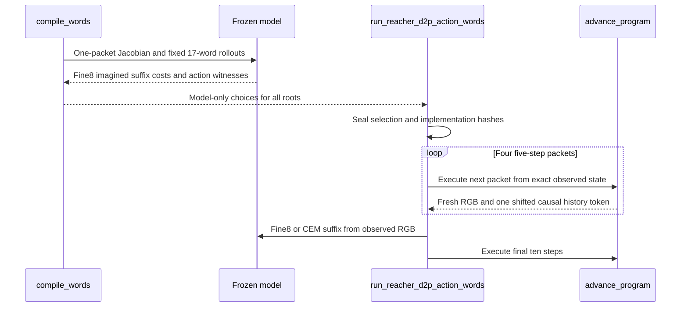

# 冻结动力学：残差锚点与动作顺序实验

## 结论边界

后续计划连续性审计已确认一处代码/协议问题：原imagined后缀被丢弃，observed
状态从零重求解会损害部分闭环分支。固定原8根全部136词的408条CUDA后缀干预
已完成，模型成本cold/warm incumbent将封存prefix平均终态距离由0.458002降至
0.124733，6胜/0负/2平；这不改变首段RGB排序，也不开放P1。新根确认与完整分解
见 [计划连续性修复](D2P_SUFFIX_CONTINUITY_REPAIR_20261026.md)。本页下述两轮是此前
各自的实验结论，不能再概括成“已排除所有代码原因”。

本页继续落实原 Planning Compiler 提案，不把此前负结果解释为理论失败，也不预设
一定存在某个尚未发现的代码错误。阶段准入、旧反转和历史结果均不改写。

本轮依次检验两个不同假设：共同残差资格是否误拒有用分支，以及单个五步包是否
不足以表达提案允许的有限动作顺序效应。两者现均已有完整主机 CUDA 证据，
但都没有修复排序或通过正式 P1。

## 已完成：共同残差与候选自身残差的隔离

原提案的局部可达代价在候选后继处同时重算残差与响应。后来新增的共同残差资格
是另一种诊断，不能作为原理论的必要条件。因此增加独立的 response-swap 对照：
固定候选自己的残差，分别代入候选、零动作、贪心分支的响应矩阵。仅当候选的
可行增益下界严格高于两个交换对照的增益上界，才保留该诊断 witness。三个 QP
共享完全相同的残差、有界动作坐标和阻尼；全部使用误差证书，不靠松动阈值。

这仍是有限局部反事实，不是原提案要求的充分必要定理，不直接替代生产策略。

证据：`le-wm-main/results/reacher_d2p_goal_local_geometry_all24_20261026_cuda.json`，
另有 `.protocol.json`、`.selection.json`、`.roots/`、`.implementation/`。

- 三任务、同八根，共 24 个已有任务/根单元，保留全部 65 个原 endpoint winner。
- 113 个响应矩阵在主机 CUDA 重算；原共同残差、端点、QP 增益和决定全部精确复现。
- 全部新决定在任何候选物理执行前封存；随后执行 120 条完整 15 步分支。
- 原四类对照的真实后继 RGB 成本、终态距离均精确复现；权重、输入与源码不变。

| 任务 | 原共同残差 witness | 自身残差交换 witness | 新诊断/原策略的平均终态距离 |
|---|---:|---:|---|
| 全驱动 | 0 | 0 | 0.015147 / 0.015147 |
| 弱肩 | 1 | 0 | 0.539206 / 0.535952 |
| 弱肘 | 0 | 0 | 0.489182 / 0.489182 |

候选自身残差检验没有发现新分支，反而拒绝唯一原有的真实有益弱肩分支。因此没有
将它替换部署 selector。共同残差并非一般必要条件的代数反例已由单测验证，但在
本批真实矩阵上，不能据此认定“共同残差导致了失败”。该诊断也不解释原32根中
两处首段 RGB 排序反转。全部 421 项相关代码测试通过；测试不是 efficacy 证据。

两张全根/全候选图（PNG、PDF、LaTeX caption、输入 SHA 和 ordinal 映射）位于
`le-wm-main/results/reacher_d2p_goal_local_geometry_figures_v2_20261026/`，已目视检查。
绘图保留全部单元；第二图用稀疏对称对数刻度，未隐藏负值或未通过候选。

## 新实现：从冻结动作响应生成有限动作词

不再只从官方动作库抽取单包候选。当前根的 RGB 历史、动作历史和原冻结模型
生成一包动作响应 Jacobian；取前两个右奇异方向，固定符号并按无穷范数归一化。
用预声明幅值 0.25、0.5，四种方向符号，生成两种四包顺序：

`(A, B, -A, -B)` 与 `(B, A, -B, -A)`。

加一个 neutral 共 17 个候选；均在单位有界动作命令中构造，再用 `atanh` 回到
既有参数 chart。每包仍含五个独立二维扭矩，不把包退化为一个重复动作。
符号平衡不意味着物理状态可逆；离散、有惯性的 LeWM 上不能称作已验证 Lie bracket。

实现映射：

| 运算 | 代码函数 |
|---|---|
| 分解、符号固定、有限动作词 | `reacher_d2p_action_words.build_words` |
| 原模型逐包想象、相同 fine8 后缀、原 endpoint selector | `reacher_d2p_action_words.compile_words` |
| 真实逐包推进与每包 RGB/历史哈希 | `reacher_d2p_action_words.advance_program` |
| 固定新根、预封存选择、全部候选物理执行及对照 | `run_reacher_d2p_action_words.main` |



对应 LaTeX 伪代码（供方法文档使用，非已通过方法）：

```latex
\begin{algorithm}[t]
\caption{Finite dynamics-native ordered-word pilot}
\begin{algorithmic}[1]
\Require Frozen model $f$, RGB/action history, goal, bounded action chart
\Ensure Sealed word bank and measured physical branch outcomes
\State Compute one-packet action Jacobian using $f$
\State Construct $17$ words with \textsc{BuildWords}
\For{each word $B$}
  \State Imagine four packets; optimize the same two-packet fine8 suffix
\EndFor
\State Select with the original non-greedy endpoint rule; seal all root choices
\For{each word and flat control at each root}
  \For{each of four prefix packets}
    \State Execute five raw steps and shift exactly one observed history token
  \EndFor
  \State Recompile from observed RGB; execute the final two packets
\EndFor
\State \Return All-root outcomes and separate forward/VJP costs
\end{algorithmic}
\end{algorithm}
```

若候选数为 $N$、前缀长 $k$、后缀长 $h$、后缀迭代数 $I$、每轮模型目标试探数
为 $L$，逻辑前向工作为 $O(N(k+I L h))$，另有逐 latent 输出坐标的 VJP，不能将
一次 vectorized Jacobian 计成一次廉价前向。实际计数以回执为准，不宣称等算力。

## 新实验冻结合同

8 个固定种子 `202642000..202642007`，按 metadata-only 准入，排除此前已测的
144 个来源 episode；不按 outcome 重采样。官方 H5 仅用于真实来源历史初始化，
动作词不读取官方 proposal 库，不训练 encoder、predictor、readout 或 policy。

每条物理分支均为 20 步前缀加 10 步后缀，且在第20步观察并重规划：

- 全部 17 个词都在全部根执行，不只测被模型选中的“好词”。
- word 的 dispatch、同库立即 greedy、neutral 共享 observed-RGB fine8 后缀。
- 平坦六包 SVD/Gauss–Newton：先联合规划六包，执行前四包，再用同一 fine8 后缀。
- 真正 CEM：六包前视后执行前四包，实际观测后再搜索两包 CEM 后缀。128样本、
  三轮、16 elites、保留历史最好样本，共3072个 predict 样本；不换成谱后缀。
- 每个模型调用检查 CUDA；有限差分、六包直推与四加二分段推演一致性、逐包
  历史、30步完整动作见证分别核查。真实 qpos 只用于评价，不进入规划。
- 新审计中精确秩一 fixture 暴露 float32 SVD 伪第二方向，现于同一设备用
  float64 分解后转回模型 dtype；这是新实现的数值防护，不是旧反转的已知原因。

实验入口：`experiments.spectral_reachability.run_reacher_d2p_action_words`。
证据保留在 `le-wm-main/results/reacher_d2p_action_words_fresh8_20261026_cuda.*`。

## 已完成：新根有限动作顺序实验

8根、136个动作词单元、另16条平坦规划对照，共152条真实30-step分支全部完成。
RTX 5060 Ti、PyTorch CUDA 13.0；无神经CPU回退，完整官方source SHA重新验证。
原权重、实现、全部封存选择均未改。逐根有限差分、六包直推/四加二分段推演、
预测样本计数、四次因果历史更新、动作范围与完整候选保留gate全部通过。
实际总预测样本数76144，包含全候选编译、有限差分及全部物理分支后缀；它不是
只部署最终一个策略的成本，不能据此作单方法效率比较。

| 方法 | 全8根平均真实终态关节距离 | dispatch减该对照的描述性95%CI |
|---|---:|---|
| 动作词 dispatch | 0.458002 | — |
| 同词库立即 greedy | 0.737025 | [-0.689097,+0.102719] |
| neutral前缀 | 0.588454 | [-0.551968,+0.193947] |
| 平坦六包SVD/GN | 1.474574 | [-1.491111,-0.520571] |
| 完整六/二包CEM | 0.120545 | [+0.073236,+0.680240] |

6个模型witness里，真实RGB前缀相对neutral仅3个仍非贪心。dispatch对同库greedy
为5胜/1负/2平，区间跨零；对CEM为1胜/7负。不能因优于本轮较弱的平坦GN就
声称程序机制成立，亦不能把所有均值优势归因于可控性改变。

独立标量/轨迹审计
`reacher_d2p_action_words_fresh8_20261026_result_audit.json`重算封存selector并按根
身份连接模型与物理结果，核对全部30步动作、每分支四个历史边界和方法alias。
128个非neutral词的前缀margin为92个符号一致、36个反转；64个固定同幅值/符号
顺序对为54个排序一致、10个反转。全部单元保留，neutral平局不算预测正确。

因此：有限动作词确实补上原方案的一种未实测程序类型，但这次实现未解决真实
排序与后缀迁移问题。所测时间分段、动作chart及选择封存有完整性证据；这不等于
穷尽了所有代码原因，也不构成理论被证伪。新诊断模块未接入正式P1准入，不开放
P2/P3/P5；独立校准/outcome、等算力强基线及C1--C3闭环仍欠缺。

两张新根/全部词图位于
`le-wm-main/results/reacher_d2p_action_words_figures_v3_20261026/`，已目视检查。
首版绘图在JSON manifest序列化时因NumPy int64中断，PNG/PDF已生成但不是完整
绘图包；已将计数显式转为Python int并增加JSON序列化单测，保留原失败目录。
此绘图错误不影响此前已封存的CUDA实验、标量审计或原排序结论。
最终相关广覆盖回归446项通过；它们仅验证代码合同，不取代上述真实结果。

## 复现（输出必须换成不存在的新路径）

以下神经实验须主机CUDA；两个后处理入口只核对既有数据，不是CPU替代实验。

```bash
cd /home/gbk/code/LeWorldModel/le-wm-main
.venv/bin/python -u -m experiments.spectral_reachability.run_reacher_d2p_action_words \
  --policy /home/gbk/.stable_worldmodel/checkpoints/reacher/lewm \
  --adapter-artifact results/reacher_d2p_p1_distribution_repair_v1_20261024_cuda/reacher_training_action_stats.json \
  --disjoint-reference results/reacher_d2p_certified_task_full_drive_fresh8_20261025_cuda.json \
  --output /absolute/new-action-words.json --seed 202642000 --roots 8
.venv/bin/python -m experiments.spectral_reachability.audit_reacher_d2p_action_word_result \
  --report /absolute/new-action-words.json --output /absolute/new-word-result-audit.json
.venv/bin/python -m experiments.spectral_reachability.plot_reacher_d2p_action_words \
  --report /absolute/new-action-words.json --output-dir /absolute/new-word-figures
```
