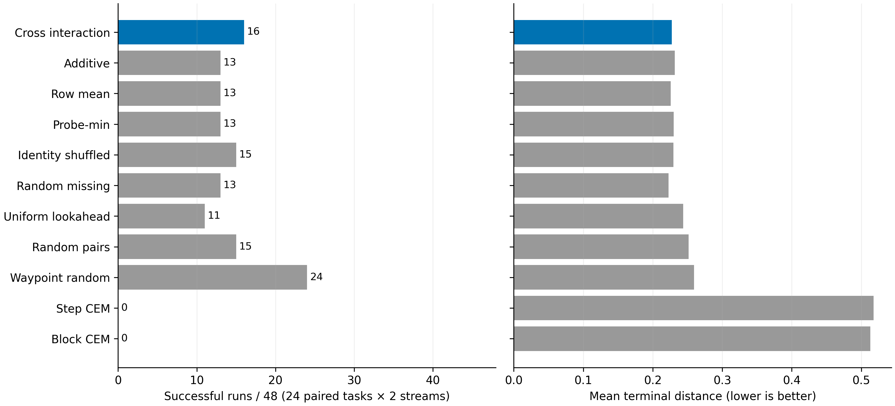
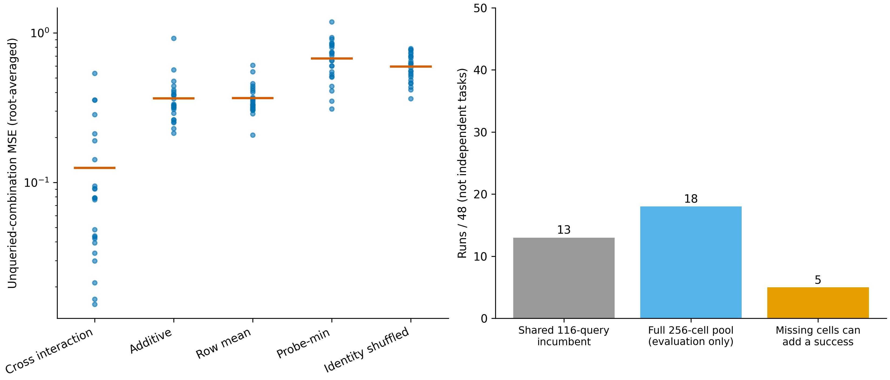

# 交叉查询：信息出口满足，部署出口不满足

日期：2026-11-07。已完成实现、固定面板全部运行、逐查询审计、全池评价、事后失败分解、回归测试和两张结果图。本次有限实验闭环完成；**整套 Planning Compiler 研究未完成，PC0–PC5 不改判。**

## 1. 问题与权限

此次从 OSFAL 逐层信息/预测传递审计及 DINO 兼容修复之后，推进到“信息能否用于合法搜索”。没有重跑已关闭的符号响应、线性描述、向量多样性或原始动作近邻配置。

新假设见[执行前协议](PC_CROSS_QUERY_INTERACTION_PROTOCOL_20261107_CODEX.md)：直接查询当前任务的少量交叉行列，重建前缀—尾部配合，再用真实模型调用验证其提出的未查询组合。它仅预测**未查询配对**，不证明对全新尾部的泛化。交叉矩阵近似本身不是新数学定理；本实验检验其在当前控制问题上的信息和部署价值。

- 精确 unicycle/墙障动力学，直接使用状态和目标坐标；**不是 RGB-only，也不是 JEPA state-assisted 视觉实验**。
- 24 个已曝光任务，每根2个生成随机流，48次配对运行；统计单位24任务。
- 每次完整动作链15步（前缀5、尾部10），11臂各128次完整链评分。
- 没有训练或更改任何视觉模型，没有读取真实后继来选择 RGB 规划器动作。
- 全池256组合在各臂选择封存并通过审计后才评价。所有入选链均实际查询，未用低秩预测代价直接代替动作验证。

## 2. 信息确实增加，但不等于控制已经改善

共同查询116条，余下140个配对用于评价未查询预测。交互模型与对照看到相同的合法已查询信息；身份打乱保留各行分数集合、破坏剩余动作身份对应。

| 预测规则 | 未查询 MSE（48次均值） | 交互模型按任务胜出 |
| --- | ---: | ---: |
| 交叉交互 | 0.124891 | — |
| 行列加性 | 0.364582 | 24/24 |
| 行均值 | 0.366011 | 辅助对照 |
| probe-min | 0.674667 | 辅助对照 |
| 动作身份打乱 | 0.593435 | 24/24 |

事前信息出口要求分别至少16/24任务优于加性和打乱，本次满足。这是本构造、有限已曝光动作支持上的开发证据；不是独立确认，不是逐层信息充分性定理，不是 PC1 通用阈值通过。

## 3. 实际选择与等查询预算

成功判据沿用终距 `<0.05`，没有修改门槛。

| 方法 | 成功/48 | 平均终距 | 中位规划 CPU 毫秒 |
| --- | ---: | ---: | ---: |
| 交叉交互 | 16 | 0.227187 | 2.379 |
| 加性 | 13 | 0.231802 | 2.457 |
| 行均值 | 13 | 0.225834 | 2.392 |
| probe-min | 13 | 0.230154 | 2.306 |
| 身份打乱 | 15 | 0.229704 | 2.439 |
| 未查询位置随机 | 13 | 0.222832 | 2.681 |
| 同池均匀 lookahead | 11 | 0.243580 | 1.461 |
| 同池随机配对 | 15 | 0.251473 | 1.484 |
| 完整 waypoint 随机搜索 | 24 | 0.259288 | 2.555 |
| 逐步 CEM | 0 | 0.517781 | 3.081 |
| 三块 CEM | 0 | 0.512879 | 3.009 |

前六臂共享候选和116条交叉查询，各自另外实际查询12条；其他臂各自使用128条完整评分。CEM为事前固定预算配置，不冒充充分调优的最终强基线。waypoint搜索改变生成方式，故与同结构信息消融分开解释。

交互臂相对加性3胜0负，相对打乱2胜1负，相对均匀lookahead6胜1负，相对完整waypoint2胜10负。按任务分组 bootstrap：

- 对加性的成功率差 `+0.0625`，95%描述区间 `[0, 0.125]`。
- 对打乱的成功率差 `+0.02083`，区间 `[-0.04167, 0.08333]`。
- 对完整waypoint的成功率差 `-0.16667`，区间 `[-0.3125, -0.02083]`。

这些是开发期描述区间，不是确认性显著性认证。交互臂相对waypoint平均终距更小、成功数却更低，也说明不能以连续指标替换已固定的主成功指标。

事前部署出口要求相对每个对照至少净增4次成功且平均终距更小，本次不满足。**不准入后续同版本机制/RGB扩大实验，停止扩大当前交叉查询配置。** 保留信息层正信号，不把整个行动后果研究一起否定。

## 4. 完整池失败分解：主要损失在候选支持，不在最终保留

| 交互臂运行分类 | 次数 |
| --- | ---: |
| 选中链成功 | 16 |
| 完整8×32池无成功链 | 30 |
| 池内有成功链，但12个提案漏掉 | 2 |
| 已查询成功链在最终选择中丢失 | 0 |

共同116查询已覆盖13次成功；完整池上限为18/48；未查询组合最多能新增5次成功，交互找回其中3次，身份打乱找回2次。完整池检查仅覆盖这个有限动作池，不能认定其他动作不可解。

两次提案漏解：

- root2/repeat1：真实成功配对 `(0,21)` 的终距0.038406，被预测为2.645523，在140个未知配对中排第138。
- root15/repeat0：三个成功配对真实终距0.032393–0.042333，被预测为2.135597–2.203798，排第107、108、110。

因此，平均MSE的稳定改善并未消除决策关键区域的巨大误差。不能把此次信息出口通过升级为全面可信的低秩动力学表示。

## 5. 原始程序被拆散的代码级设计损失

按[事后诊断附录](PC_CROSS_QUERY_FAILURE_AUDIT_ADDENDUM_20261107_CODEX.md)，评价端重放最初生成的39条完整名义链：前8条只提供前缀，后31条只提供尾部。原始完整链没有进入原规划器的已评分集合。

结果：

- 39条名义链中至少有一条成功的运行：24/48。
- 其中8次，名义链存在成功，而拆分后的8×32组合池不存在成功。
- 其中4次，前8条中的完整名义链已可成功，但其原有尾部不在共同尾部库：root0/1、root4/0、root6/0、root17/1。
- 后31条名义链提供的成功前缀，在上述8次中也有被排除的实例。

这直接指向 `pc_cross_query/exact_run.py` 的 `bank()`：`chains[:8,:5]` 与 `chains[8:,5:]` 只保留了互不对应的片段，丢掉原始完整程序配对。**它是协议中明确采用但现在被证实有覆盖损失的构造规则，不是发现了与协议相违背的索引错误。**

这组重放增加1872条**评价端**查询，不进入部署成本或成功数；不能把24/48补记为交互臂成功。它支持下一版本在合法查询预算内保留完整名义链及其来源，再测试描述是否有额外增量；不支持现在免费加入这些链、扩大seed或追溯更换出口。

## 6. 对负结果进行的实现检查

1. 528个计划的全部查询动作、后继、评分、实际最佳链、预算、提案来源均重算。
2. 新后端实际执行15步，与旧16步padding后端的第15步比对，评分误差0；没有少计隐藏padding步。
3. 独立标量表达重算528条选中轨迹，与批实现最大误差0。
4. 48个交叉矩阵的有效交互秩均为2；每个动作池都有8个不同前缀、32个不同尾部。
5. 使用独立 `lstsq` 公式重算交互预测，与主 `pinv` 实现最大差 `2.665e-15`。
6. CEM零成功另核验精英身份、均值和方差更新、全部实际候选与碰撞轨迹：每种CEM共6144条候选均未成功；step候选0条越过墙平面，block候选20条越过。未发现评分或更新不符合配置。这不证明所有CEM都无效，亦不排除配置探索不足。
7. 定向回归 **27 passed**，包含权限、动作、数值、未知项泄露、预算、时钟和旧生成器测试。

这些检查排除了本次检查范围内的具体实现差异，不能称为全仓逐行审计，也不能证明绝无bug。

## 7. 计费与可恢复性

- 每臂部署：128条完整链、1920个精确动力学步。
- 实际规划runner：39744条（共同116查询物理复用，但每臂承担对应逻辑部署成本）。
- 后置全池评价：12288条；选中链回放528条。
- 后置名义链评价：1872条；CEM附加审计12288条。
- 逐查询审计和测试额外重算不进入规划器部署量；不能混淆实验总算力与方法成本。

计时包括生成、当前任务近似、分配、模型执行、最终选择；不包括加载、JSON持久化、评价重放或视觉编码。本实验CPU运行，不涉及GPU或完整反馈环境成本，也不据毫秒级单次计时声称系统效率优势。

原始文件位于 `le-wm-main/results/pc_cross_query_interaction_20261107/`，包括manifest、48份plan、48份evaluate、audit、summary、failure_decomposition。所有核心来源已绑定；支持校验后跳过的断点续跑：

```bash
cd /home/gbk/code/LeWorldModel/le-wm-main
OPENBLAS_NUM_THREADS=4 OMP_NUM_THREADS=4 .venv/bin/python -m experiments.pc_cross_query.exact_run all
OPENBLAS_NUM_THREADS=4 OMP_NUM_THREADS=4 .venv/bin/python -m experiments.pc_cross_query_failure_decomposition_20261107_codex
OPENBLAS_NUM_THREADS=4 OMP_NUM_THREADS=4 .venv/bin/python -m experiments.pc_cross_query.plot
```

方法源代码已封存；后续修改须另立版本，不能让现有manifest静默接受漂移。

## 8. 图与研究决策

两张图已导出可编辑SVG、PDF及300DPI PNG，并实际查看PNG确认坐标范围、文本和分母。





`experiment-design` / `experiment-code` 促使本轮先固定比较、出口和隔离，再实际执行；`code-debugging` 用于独立数值、时钟及零成功检查；`figure-generation` 用于把信息增量与控制结果并列呈现。没有以技能中泛化的“非零准确率”要求修改结果。

**当前决定：信息近似在本面板可用，但当前候选构造和分配规则未达到部署门槛。原始完整程序配对的覆盖损失有直接证据，应先处理这一点；两处决策关键组合的预测误差则必须独立保留为信息失效。** 不继续扩大本配置，不把它接入GPU确认，不把后验名义链成功伪装为方法收益。RGB-only主协议、独立任务来源和整套gate仍保持原要求。
