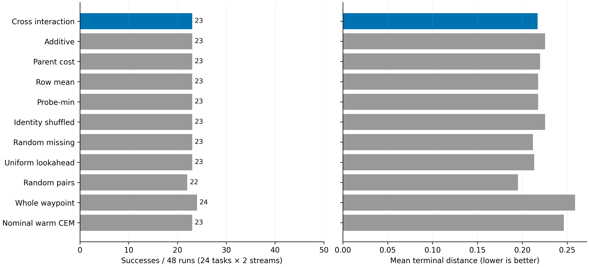
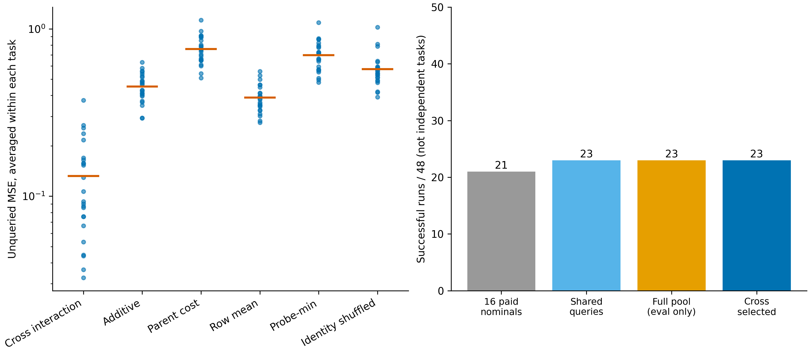

# 完整链保留已修复；交叉描述仍无部署增量

执行完成：2026-11-08（Asia/Shanghai）。协议及代码目录沿用启动时的20261107版本号。原始旧版结果没有覆盖。

本轮落实上一轮发现的具体候选构造问题：原始完整程序被拆散后，其自身尾部可能不在共同尾部库。现已实现“完整名义链实际评分、计费、始终参与最终比较”的不变量，并跑完24任务×2随机流×11臂。**工程修复通过，科学部署出口未满足。整套Planning Compiler目标仍未完成。**

## 1. 已落实的代码修改

实现：`le-wm-main/experiments/pc_lineage_cross/`。

- `core.py`：`PairedBank`接收16条完整15步链，以相同来源形成5步前缀和10步尾部；16个`(i,i+1)`组合逐字节等于原链。只读动作数据、整数身份、动作边界和时钟均有检查。
- 先实际评分16条名义链，再查询4个共同列、3个锚点行；跳过已评分的原始配对，避免重复计费。
- 全部共同查询113–116次，剩余12–15次才用于各规则的提案；**各臂总预算仍是128条完整链**，不是给修正版额外预算。
- 7个同信息臂共享相同16条原链、共同查询、候选权限和最终已评分最优选择。
- `run.py`新增同名义链热启动CEM：同样计费16条原链，之后112次全链搜索。完整waypoint对照前16条也完全相同。
- `audit.py`逐原始记录检查所有动作、查询预算、选中链、CEM精英更新和名义链保留。
- `pc_lineage_pool_bound_20261108_codex.py`从封存全池轨迹单独重算终距与成功上限，不增加模型查询。

这既改变了行列支持（旧8×32，新16×17），也改变了名义链保留规则，因此不把旧新版的成功数差异归因为一个孤立开关。**描述增量只在新版本内部的同机会对照间判定。**

## 2. 协议与证据边界

事前协议：[PC_LINEAGE_PRESERVING_CROSS_PROTOCOL_20261107_CODEX.md](PC_LINEAGE_PRESERVING_CROSS_PROTOCOL_20261107_CODEX.md)。

- 仍为已曝光的24个精确墙障任务、每根2个生成流；不是48个独立任务。
- 精确state和动力学输入；没有使用RGB世界模型或GPU，没有修改任何checkpoint。不是RGB-only证据。
- 成功仍为15步终距`<0.05`。前缀5步、尾部10步；动作界限和物理缩放不变。
- 所有提案都须实际查询后方能进入最终选择；未知矩阵格保持NaN。
- 完整272候选的评价在全部计划封存、逐查询审计后运行，不回流规划决策。
- 没有新训练、离线拟合读出、未来真实后继泄露或免费评价端最优尾部。

## 3. 保留规则验证结果

528份计划均满足：

1. 原始16条完整链确实出现在第一批计费查询中。
2. 该批动作字节与候选池中的原始配对一致。
3. 最终选中代价不差于最好的原始名义链。
4. 全部128次查询可从原始轨迹核对；交叉查询不存在配对身份重复。

评分与旧padding后端第15步比对最大差0；独立标量轨迹比对最大差0；独立`lstsq`与主`pinv`交互公式最大差`2.665e-15`。热启动CEM的初始化、每轮精英和更新也已重算。

定向回归 **38 passed**。测试和这些有限一致性检查不等于全仓无bug，更不等于gate通过。

## 4. 信息出口再次满足

共同未查询位置的MSE先在每个任务内平均两个流。交互模型在24/24根分别优于加性和身份打乱，超过事前16/24的本次开发出口。

| 预测规则 | 未查询配对MSE |
| --- | ---: |
| 交叉交互 | 0.132138 |
| 加性 | 0.452971 |
| 父链代价 | 0.758180 |
| 行均值 | 0.388000 |
| probe-min | 0.696058 |
| 动作身份打乱 | 0.575456 |

这是当前任务中未查询**配对**的开发预测价值，不是全新尾部泛化，不是视觉后果可信性认证。额外保留的名义配对是已合法查询信息；不能把它们计入未查询预测评价。

## 5. 控制结果没有描述增量

| 方法 | 成功/48 | 平均终距 | 中位规划CPU毫秒 |
| --- | ---: | ---: | ---: |
| 交叉交互 | 23 | 0.216945 | 2.565 |
| 加性 | 23 | 0.225304 | 2.622 |
| 父链代价 | 23 | 0.219768 | 2.516 |
| 行均值 | 23 | 0.217654 | 2.498 |
| probe-min | 23 | 0.217603 | 2.477 |
| 身份打乱 | 23 | 0.225358 | 2.737 |
| 随机未知组合 | 23 | 0.211941 | 2.487 |
| 均匀lookahead | 23 | 0.213232 | 1.501 |
| 随机配对 | 22 | 0.195178 | 1.508 |
| 完整waypoint随机搜索 | 24 | 0.258878 | 3.357 |
| 同名义链热启动CEM | 23 | 0.246355 | 3.541 |

各臂都是128个完整查询、1920个精确动力学步。所有臂均保留了原始名义链21/48的成功；交叉共同查询增加2次，后续描述提案没有再增加成功。

交互臂对加性、身份打乱、均匀lookahead的成功/失败身份完全相同，不只是总数巧合相同。与热启动CEM为2胜2负，与完整waypoint为2胜3负。按24根bootstrap的成功率差区间：

- 对同池加性/打乱/均匀lookahead：`[0,0]`（仅描述本开发面板的完全相同结果，不是总体等价性证明）。
- 对热启动CEM：`[-0.08333,0.08333]`。
- 对完整waypoint：`[-0.125,0.08333]`。

均匀lookahead同样23/48，平均终距更小、当前CPU计时也更低。因此本轮不能改用“成本优势”挽救描述主张。未事前声明的非劣效界也没有被补设。

## 6. 固定候选池成功上限已达到

| 阶段/集合 | 能成功的运行数 |
| --- | ---: |
| 原始16条名义链 | 21/48 |
| 共同113–116查询 | 23/48 |
| 评价端完整16×17池 | 23/48 |
| 交互臂实际选中链 | 23/48 |

独立数组审计从全部13056条池内轨迹重算末态终距，核查选中动作确实属于对应池，并确认**逐运行**的选中成功与池内可成功标志一致。

由此得到有限范围内的确定结论：对这些已封存的候选池、15步时域和终点成功规则，任何只改变评分、保留或预算分配、但不生成池外动作的方法，都不可能让成功数超过23/48。该结论不是抽样未找到解的推测。

它不限制：

- 当前池外的其他可执行动作；
- 允许新生成器或完整链优化的其他方法；
- 其他任务/时域；
- 连续终距进一步改善；
- 世界模型或真实视觉环境的可达性。

失败分解因此为：23成功、25池覆盖失败、0提案漏解、0最终选择丢解。当前继续调整近似秩、排序权重或seed，不能替代新的候选生成依据。

## 7. 成本、复现与封存

实际runner共享计算后调用31710条完整链；各部署臂仍独立承担128查询的逻辑成本。后置全池评价13056条、选中链回放528条；审计重算另计，不算方法部署预算。

计时覆盖生成、当前任务查询/近似、选择和优化；不含模型加载、结果写盘和评价回放。它不是完整视觉闭环成本，也不是GPU效率证据。

原始产物：

`le-wm-main/results/pc_lineage_preserving_cross_20261107/`

含manifest、48份plan、48份evaluate、audit、summary、finite_pool_bound。源码及协议哈希绑定，断点入口会校验并跳过完成项，不重跑旧实验：

```bash
cd /home/gbk/code/LeWorldModel/le-wm-main
OPENBLAS_NUM_THREADS=4 OMP_NUM_THREADS=4 .venv/bin/python -m experiments.pc_lineage_cross.run all
OPENBLAS_NUM_THREADS=4 OMP_NUM_THREADS=4 .venv/bin/python -m experiments.pc_lineage_pool_bound_20261108_codex
OPENBLAS_NUM_THREADS=4 OMP_NUM_THREADS=4 .venv/bin/python -m experiments.pc_lineage_cross.plot
```

图已导出SVG/PDF/300DPI PNG，并查看确认文本、坐标和分母：





## 8. 研究决定

依据事前出口：工程保留不变量通过，信息出口满足，部署出口不满足。**封存本配置，不继续扩大，也不接入GPU/RGB确认。** 旧版和新版的负结果、所有失败分母及阈值均保留。

本轮不是又一次“可能有bug”的泛泛解释：已按证据实现并验证完整链保留，同时明确看到该修复并未产生描述组件的独立成功率增量。剩余25次失败有完整有限池覆盖证据；当前应把研究压力放到在同预算下生成池外的合法有用程序，而非继续争取已封存矩阵的排序阳性。

`experiment-design`与`experiment-code`用于锁定同机会/同预算对照和断点记录；`code-debugging`用于实际保留、时钟、数值及精英更新审计；`figure-generation`使预测与控制结果分开展示。未用技能中“非零准确率”的通用措辞改变结论。

此处只完成了这一候选构造的闭环。没有把它替代为完整研究目标；RGB-only主协议、同一版本PC2–PC4、强基线完整成本和独立PC5要求均未放宽。
