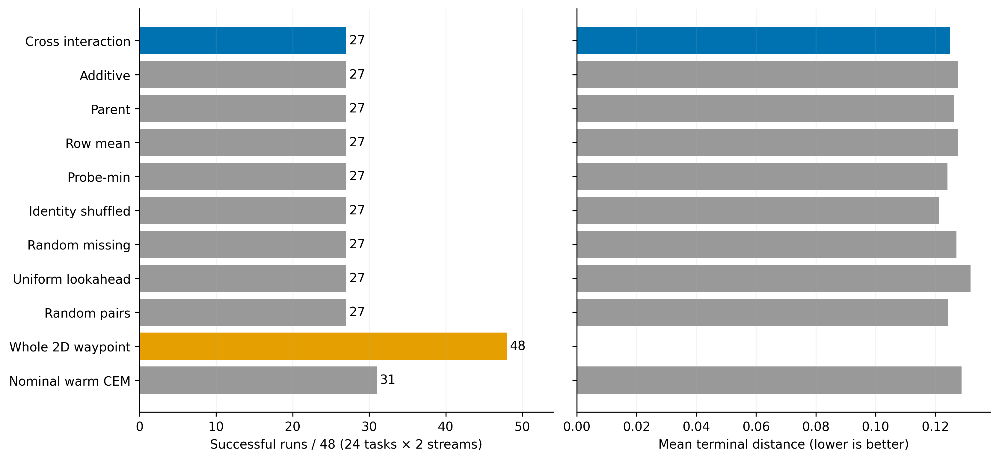
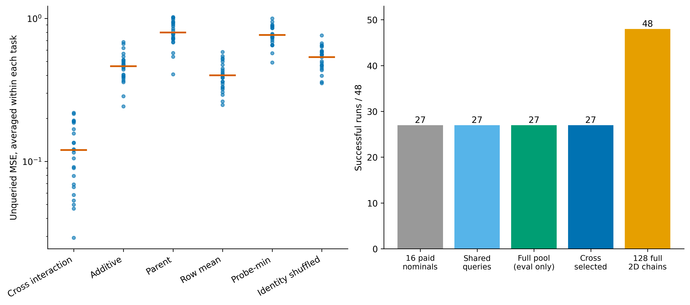

# 更强生成器接入后：交叉信息仍未带来程序发现增量

执行日期：2026-11-08（Asia/Shanghai）。本轮已完成新协议、实现、测试、48份计划封存、查询审计、全池评价及独立重算。

**结论：二维生成的改进不能归因于交叉描述。** 用相同二维名义链构造的来源保持搜索及其同池对照全部27/48，完整二维生成48/48，热启动CEM31/48。交互预测在24/24任务上优于加性与身份打乱，但整个组合池没有产生一个原始16条名义链尚未覆盖的成功运行。该二维交叉构造按执行前规则停止，完整Planning Compiler目标未完成。

## 1. 为什么运行这个版本

此前二维生成在同128查询预算下将旧一维24/48提升到48/48，全部候选独立重放通过。旧交叉版本则受一维候选支持限制。这给出了一个明确的单因素问题：

> 保持描述、查询分配、配对保留、5/10切分及最终选择不变，只改善名义链生成支持，是否能使交叉信息产生真实搜索增量？

本轮不是给旧停止配置更换seed，也没有修改旧阈值。协议为
`docs/PC_PLANE_LINEAGE_CROSS_PROTOCOL_20261108_CODEX.md`，实现为
`le-wm-main/experiments/pc_plane_lineage_cross/`。旧实验目录和源码保持不变。

新生成使用与上一轮纯二维臂相同的两个预定随机流；前16条二维完整链作为名义链。16个5步前缀与16个10步尾部、加hold，形成16×17池。所有原始配对先实际查询并始终保留。

四个共同列、三个锚点行、交互近似、加性回归、身份打乱、CEM更新和首个实测最小代价选择均复用原实现。本轮没有新学习、缓存提速、语义切分或条件尾部重新生成。

## 2. 权限与实验单位

- 24个已曝光的解析墙障任务，每任务两个生成流，共48次运行；不是48个独立任务。
- 每臂128条完整15步查询，即1920个解析动力学转换；成功为第15步终距`<0.05`。
- 使用真实初始姿态、目标位置与解析动力学，属于exact-state算法开发，不是JEPA state-assisted实验，更不是RGB-only。
- 全部计划封存、查询审计完成之后才读取完整272格评价矩阵。规划端未知格保持NaN。
- 每臂有相同16条计费原链；同信息臂还共享相同交叉观测及剩余查询数。没有把评价端最佳尾部免费用于初始化。
- 完整二维对照的6144条动作和代价均复现上一轮封存的纯二维臂。

## 3. 实现核验

本轮不把负结果直接解释成理论失败，执行了以下原始轨迹检查：

| 核验 | 结果 |
| --- | --- |
| 随机流、名义动作及动作字节指纹重建 | 48次全部一致 |
| 查询总量、配对去重、完整原链保留及最终选择 | 528份计划全部通过 |
| CEM每批采样、均值、方差、elite与更新重建 | 全部一致 |
| 所有部署臂查询的独立标量重放 | 67584条，轨迹和代价最大误差0 |
| 交互公式pinv与独立lstsq表达式 | 最大差`3.99680e-15` |
| 全部272候选池的独立标量重放 | 13056条，最大误差0 |
| 每条池内链拆为5步后继接10步尾部、保持真实朝向 | 13056条，和完整15步积分最大误差0 |
| 定向回归 | **50 passed** |

测试包括无效候选数、动作来源、未知矩阵格泄露和错误最终选择的拒绝，以及此前来源保持、几何生成和墙障回归。上述是本合同和有限动作集合的实现证据，不是全仓审计、独立环境复现或科学gate通过。

这里的分段重放特别排除了“切分时错误重置朝向或物理时钟”这一实现解释。它不证明当前固定5/10切分具有合适的程序语义；正确拼接动作与生成有效新程序仍是两件事。

## 4. 信息预测仍然成立

以下只在共同交叉观测之外的未知配对上评价；原始已查询配对不算held-out：

| 预测规则 | 未查询配对MSE |
| --- | ---: |
| 交叉交互 | 0.120295 |
| 加性 | 0.462217 |
| 父链代价 | 0.797169 |
| 行均值 | 0.399189 |
| probe-min | 0.765525 |
| 身份打乱 | 0.535336 |

按根平均两个流，交互分别在24/24任务上优于加性和打乱，超过本轮事前16/24的信息出口。

这证明本有限候选分布中的动作身份有配对预测价值，不能升级为全新尾部泛化、视觉后果信息可信性或搜索价值。

## 5. 实际选择没有描述增量

| 方法 | 成功/48 | 平均终距 | 当前CPU中位规划毫秒 |
| --- | ---: | ---: | ---: |
| 交叉交互 | 27 | 0.124834 | 2.597 |
| 加性 | 27 | 0.127518 | 2.654 |
| 父链代价 | 27 | 0.126296 | 2.552 |
| 行均值 | 27 | 0.127518 | 2.518 |
| probe-min | 27 | 0.124104 | 2.511 |
| 身份打乱 | 27 | 0.121288 | 2.770 |
| 随机未知组合 | 27 | 0.127029 | 2.515 |
| 均匀lookahead | 27 | 0.131811 | 1.547 |
| 随机配对 | 27 | 0.124269 | 1.541 |
| 完整二维生成 | 48 | 2.00422e-16 | 3.550 |
| 同名义链热启动CEM | 31 | 0.128790 | 3.566 |

所有固定池臂的成功身份相同，不只是成功总数碰巧相同。交互对加性、身份打乱、均匀lookahead分别为0胜0负，未满足“各净增至少4/48且平均终距更低”的组件利用出口。

交互相对加性连续终距有小幅改善，但身份打乱和probe-min平均终距反而更低；不能仅选择有利比较宣称整体描述优势。相对热启动CEM为0胜4负，相对完整二维为0胜21负。

按24任务、10000次预定bootstrap，交互成功率差：

- 对加性/打乱/均匀lookahead：`[0,0]`，仅反映这个开发面板中身份完全相同，不是总体等价证明。
- 对热启动CEM：`[-0.166667,-0.020833]`。
- 对完整二维：`[-0.604167,-0.270833]`。

没有事后改为非劣效或成本主张。CPU计时不构成独立收益确认；完整二维对照在本来源保持runner中还包含原始16链构造后重新生成128链的工作，不能用这个未优化的毫秒开销给交叉方法制造效率优势。上一轮直接生成实现的计时另有封存，不混在本表。

## 6. 全池证明：组合没有扩展成功任务覆盖

| 合法支持集合或阶段 | 有成功链的运行数 |
| --- | ---: |
| 16条原始二维名义链 | 27/48 |
| 付费共同交叉查询 | 27/48 |
| 评价端完整16×17池 | 27/48 |
| 交互实际选中链 | 27/48 |
| 128条完整二维生成链 | 48/48 |

独立重放确认，逐运行的池内可成功与实际选中成功一致。全272格重组**没有增加任何原始16条链尚未成功的运行**。

因此本配置失败分解为：

- 27成功；
- 21固定池覆盖失败；
- 0提案漏解；
- 0最终选择丢解。

这比“评分可能不好”更具体：在已封存的有限池和当前终点规则下，任何只重排或重分配这些格子的算法，都无法增加终点成功。更准确的交互预测并没有创造池外动作。

不应反向推断所有程序组合都无效。这里是固定时间切分后的原始控制序列拼接，不是语义边界、条件尾部再合成或连续整链优化。后两者若提出新假设，需要新协议和独立比较，不能用本有限池的负结果直接否定。

## 7. 成本、原始产物与复现

`le-wm-main/results/pc_plane_lineage_cross_20261108/`保存manifest、48份plan、audit、48份evaluate、summary及pool_audit。

各臂独立承担128个完整查询的逻辑预算；runner复用共同计算后实际调用31734条规划链。全池评价13056条，选中链评价528条；查询审计67584条独立标量重放，全池审计及分段验证各13056条。评价费用单列，不充当部署预算。

没有GPU、视觉编码、真实环境反馈或完整系统成本主张。没有修改任何checkpoint或RGB输入权限。

```bash
cd /home/gbk/code/LeWorldModel/le-wm-main
OPENBLAS_NUM_THREADS=4 OMP_NUM_THREADS=4 .venv/bin/python \
  -m experiments.pc_plane_lineage_cross.run all
OPENBLAS_NUM_THREADS=4 OMP_NUM_THREADS=4 .venv/bin/python \
  -m experiments.pc_plane_lineage_cross.pool_audit
OPENBLAS_NUM_THREADS=4 OMP_NUM_THREADS=4 .venv/bin/python \
  -m experiments.pc_plane_lineage_cross.plot
```

完成阶段按源码和原始记录哈希验证后跳过。原始一维实验、二维生成实验和本实验分开保留。





图同时输出SVG、PDF及300DPI PNG，已实际打开检查坐标、分母和标签；主入口与全池审计也已再次执行，验哈希后跳过完成计算。`experiment-design`与`experiment-code`约束单因素、付费查询和封存顺序；`code-debugging`要求独立公式、采样、选择及分段积分核验；`figure-generation`使预测与控制证据分开展示。

## 8. 研究决定

1. **二维生成的开发改进保留；二维交叉组合配置停止。** 不能把前者的48/48宣传成后者的成功。
2. **当前瓶颈不是这套固定池的最终排序。** 当前完整池已经给出确定上限，继续调秩、符号、权重或重复seed不解决覆盖问题。
3. **动作身份信息有预测价值，但目前的消耗方式没有提供成功率增量。** 当前大部分预算用于查询和补全一个不增加成功任务的组合池。
4. **完整二维生成和热启动CEM必须保留为强对照。** 后续候选需要解释其池外新程序来自何处、信息如何帮助生成或条件优化，以及为何值得额外成本。
5. **总目标不改判完成。** 尚无同一冻结版本建立描述贡献、正式同链机制、独立净收益及RGB-only闭环泛化。此处只完成一次有明确否定出口的单因素检验。
