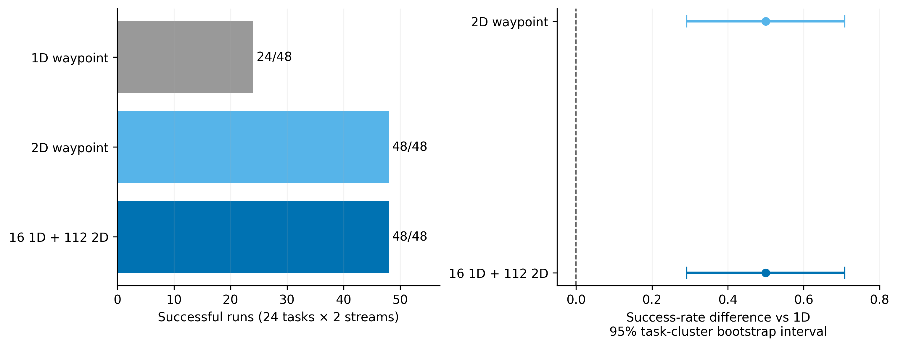
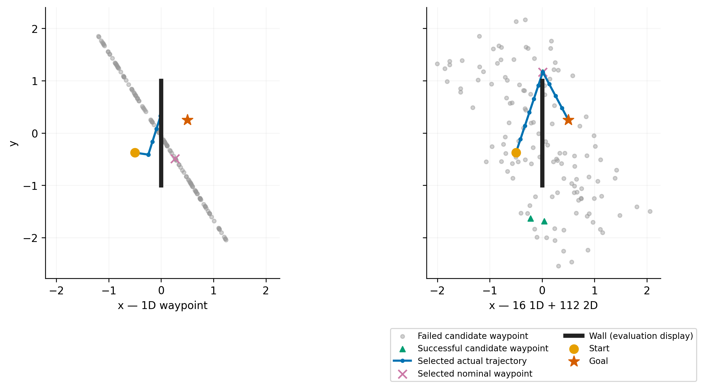

# 同预算二维 waypoint 消除了本面板的一维生成覆盖失败

执行日期：2026-11-08（Asia/Shanghai）。执行前协议、原始动作、评价和独立重算均已封存。没有覆盖或重开已停止的交叉描述版本。

**主要结果：相同128次完整链查询、15步执行，旧一维 waypoint 为24/48成功，二维及混合生成均为48/48。** 这次观察到的是有独立重算支持的候选生成改进，不是通过扩大seed、时域或预算获得的成绩。它使精确动力学基线更强，但没有建立行动后果描述贡献、RGB-only规划收益或PC0–PC5整体通过。

## 1. 实际修改与比较

上一轮已从完整候选池证明：已停止的来源保持交叉配置达到其池内成功上限，继续只改排序不能改善成功数。本轮只改变池外候选的几何生成支持。

旧生成器将中间点限制在起终点连线的垂直平分线上：

`waypoint = midpoint + lateral * [-dy, dx]`

新生成器增加沿起终点连线的自由度：

`waypoint = midpoint + lateral * [-dy, dx] + longitudinal * [dx, dy]`

其中 lateral 仍为预定的均匀[-2,2]，longitudinal为独立均匀[-1,1]；不读取障碍位置、墙高或候选的未来结果。生成器使用当前任务的真实初始姿态、目标坐标，因此只适用于本次**exact-state算法开发协议**，不是RGB-only生成器。

三臂共享24个已曝光任务、每根2个随机流、动作界限、动作编译、精确模型、评分和最终已评分最优选择：

| 臂 | 实际查询的完整链 |
| --- | --- |
| 一维 | 128条原始一维生成链 |
| 二维 | 128条二维生成链 |
| 混合（事前主候选） | 前16条与一维完全相同，后112条与二维对应候选完全相同 |

每条链恰好执行15步；名义程序超长则显式截断并记录所需长度，没有追加环境步。全部48份三臂计划先封存，之后才做候选物理重放、无墙积分和特权可解性见证。见证没有参与规划。

## 2. 实现与评价核验

代码：

- `le-wm-main/experiments/pc_waypoint_geometry_20261108_codex.py`
- `le-wm-main/experiments/pc_waypoint_geometry_audit_20261108_codex.py`

通过的有限核验：

1. 一维候选与历史编译器逐动作一致；48次运行的全部6144条一维链及代价，与上一轮封存的同seed完整waypoint基线一致。
2. 所有所需长度不超过15步的链，在独立无墙积分下抵达指定目标；最大终距误差为`2.13628e-15`，低于事前`1e-10`容差。
3. 全部18432条候选按封存种子重新生成；动作、waypoint、所需长度、片段边界和混合来源全部一致。
4. 全部18432条候选另用独立标量墙障动力学重放，276480个实际转换；与保存的完整批量轨迹相比最大误差0，终距误差0。
5. 三臂144次选择均取实际查询池的首个最小代价，且逐次达到该池的成功上限。没有已有成功链被最终选择丢失。
6. 特权评价端48条几何见证中，每个任务至少一条在15步内成功：24/24任务可解。这只能认证该解析环境和动作合同的可行性，不能输入RGB规划器。
7. **43项定向测试通过**，包括新编译器、严格成功边界、选中身份、无效输入、旧交叉/来源保持及墙障审计回归。不是全仓测试或普遍无bug证明。

历史版本和源码哈希未被覆盖。上述结果支持排除本轮已测试的编译、时钟、预算、随机流和评价不一致，不意味着所有理论或实现问题已经解决。

## 3. 控制结果与事前出口

成功规则始终为第15步位置距目标`<0.05`。

| 方法 | 成功/48 | 平均终距 | 当前CPU中位规划时间 |
| --- | ---: | ---: | ---: |
| 一维 | 24 | 0.258878 | 2.552毫秒 |
| 二维 | 48 | 2.00422e-16 | 2.458毫秒 |
| 混合 | 48 | 1.84911e-16 | 2.451毫秒 |

混合相对一维为24胜、0负，即12个任务在两个流上均得到改善。以**24个任务**为重采样单位，10000次预定bootstrap：

- 成功率差：+0.5，描述性95%区间`[0.291667, 0.708333]`。
- 平均终距差：-0.258878，描述性95%区间`[-0.365958, -0.151595]`。

混合满足执行前冻结的“净增至少4/48成功且平均终距下降”开发出口。二维也是48/48，**没有显示额外保留16条一维链能进一步改善128查询下的成功率**。没有因为两臂都成功就事后修改主候选。

这些任务已被开发使用，两个生成流不是独立任务。区间不是独立确认结论；接近机器精度的终距来自本解析模型，不代表真实视觉系统的精度。

## 4. 失败究竟来自哪里

每臂6144条候选的完整分类：

| 候选类别 | 一维 | 二维 | 混合 |
| --- | ---: | ---: | ---: |
| 失败，碰撞且无墙也失败 | 743 | 800 | 795 |
| 失败，仅碰撞 | 4230 | 3966 | 3998 |
| 失败，仅无墙失败 | 673 | 1048 | 996 |
| 其他失败 | 0 | 0 | 0 |
| 成功 | 498 | 330 | 355 |
| 名义所需步数>15（另列，非额外分母） | 1416 | 1848 | 1791 |

本面板中无墙失败对应名义链超长；没有观测到完整合法短链的无墙编译失效。类别按执行15步内的真实碰撞和无墙终距定义，不把未执行的理想几何段当成实际后果。

对**实际选中的失败链**：

- 一维24条失败链全部发生碰撞，所需长度均≤15步；无墙终距仅有浮点误差。因此它们的失败不是动作截断造成。
- 混合48条选中链所需长度11–15步，全部无碰撞、终点成功。
- 每个候选池的选中成功与池内存在成功逐点一致；本次没有选择丢解。

值得注意：一维候选的总成功条数反而更多（498对355），却覆盖更少任务。**“生成了更多成功候选”与“覆盖更多任务”不是同一个指标。** 新自由度将成功分配到了旧版缺失的任务，而非简单提高全体候选的平均成功比例。

因此，当前证据支持：旧参数化的有限生成支持是该面板的重要限制；增加一个可检验的几何自由度能在同预算下消除观测到的覆盖失败。没有证明一维连续参数空间在所有任务上绝对不可解，也没有把这一设计限制称为已定位的低层编译bug。

## 5. 示例图与完整分母

第一张图报告全部48次运行和按任务汇总的不确定性。第二张图按固定顺序选择首个改善样例root1/stream0，仅解释几何，不作为性能子集。





该例的一维选中链需要8步，但在墙前被阻挡；混合选中链的waypoint为约`(0.01218,1.16590)`，需要14步，在同15步合同内绕墙到达目标。图中的墙和成功标签来自评价端，仅用于解释封存结果。

两个图均有可编辑SVG、PDF及300DPI PNG，已经实际打开检查文本、坐标、路径和图例。绘图源码和原始证据哈希另存`figure_sources.json`。

## 6. 成本与复现

原始目录：

`le-wm-main/results/pc_waypoint_geometry_20261108/`

包含manifest、48份plan、48份evaluate、summary、独立全候选审计与notes。

部署逻辑成本每臂每次128条链×15步；三臂48次共18432条规划查询。后置评价另做18432条批量重放、18432条无墙积分、144条选中链标量重放和48条特权见证。独立审计再做18432条标量重放，全部是评价成本，不能隐藏为部署预算。

计时覆盖生成、精确模型批量评分和选择；不含审计、写盘、模型加载、视觉编码或闭环反馈。毫秒级单次CPU中位数仅作运行记录，不据此宣称成本优势。这不是GPU或完整系统质量—成本曲线。

```bash
cd /home/gbk/code/LeWorldModel/le-wm-main
OPENBLAS_NUM_THREADS=4 OMP_NUM_THREADS=4 .venv/bin/python \
  -m experiments.pc_waypoint_geometry_20261108_codex all
OPENBLAS_NUM_THREADS=4 OMP_NUM_THREADS=4 .venv/bin/python \
  -m experiments.pc_waypoint_geometry_audit_20261108_codex
OPENBLAS_NUM_THREADS=4 OMP_NUM_THREADS=4 .venv/bin/python \
  -m experiments.pc_waypoint_geometry_plot_20261108_codex
```

主入口和独立审计已经再次执行，校验后跳过已完成计算，不覆盖历史数据。

## 7. 研究决定

1. **接纳二维/混合生成作为后续精确动力学开发的更强基线资产。** 它通过了本次生成器开发出口；保留三臂及所有原始失败结果。
2. **不将其改名为行动后果描述的成功。** 本次没有描述、谱提案或保留打分增量；主要改进是几何候选生成支持。
3. **不重开已停止的同池交叉描述配置。** 新生成基线在当前128查询面板上已经48/48；继续以旧一维或冷启动CEM为唯一对照，会低估强基线。
4. **不晋级RGB或Full Planning Compiler。** 使用真实姿态和解析动力学；未验证视觉后果可信性、描述帮助发现、实际同链机制的完整干预、独立任务净收益或跨模型闭环。
5. 后续开发必须以这个更强基线为对照，并先提出可检验的描述利用/成本假设；不能将本结果与另一个版本的PC1或机制阳性拼接成完整方法。

`experiment-design`保留事前预算与出口，`code-debugging`要求无墙、旧版、独立标量和选择来源核验，`experiment-code`及`figure-generation`用于可恢复证据产物和实际图像检查。技能中的通用“非零准确率”建议没有改变实验判据。

此处完成了生成覆盖假设的实现—运行—复算—决策闭环。整套Planning Compiler研究目标继续保持未完成；工程进展和科学Gate分开登记。
